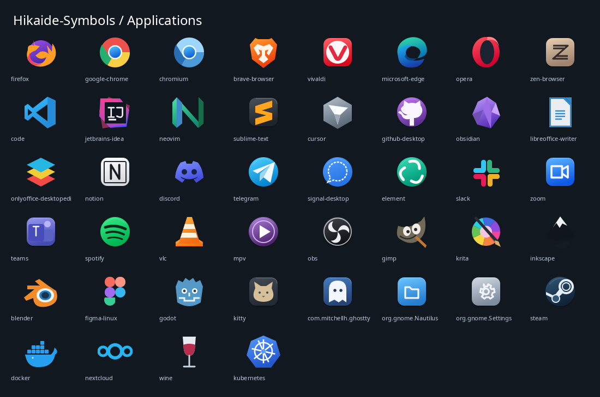
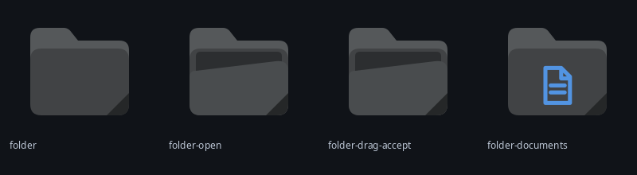
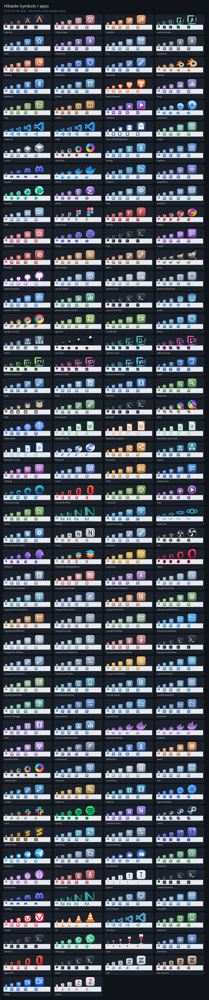
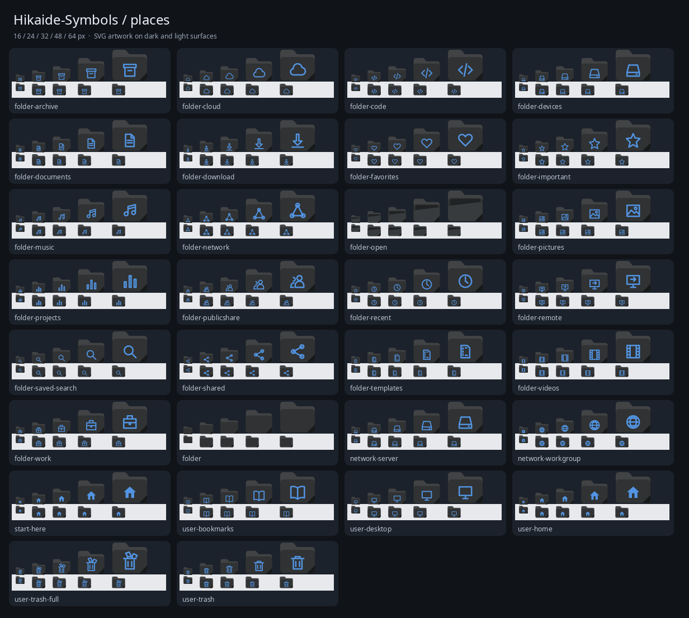
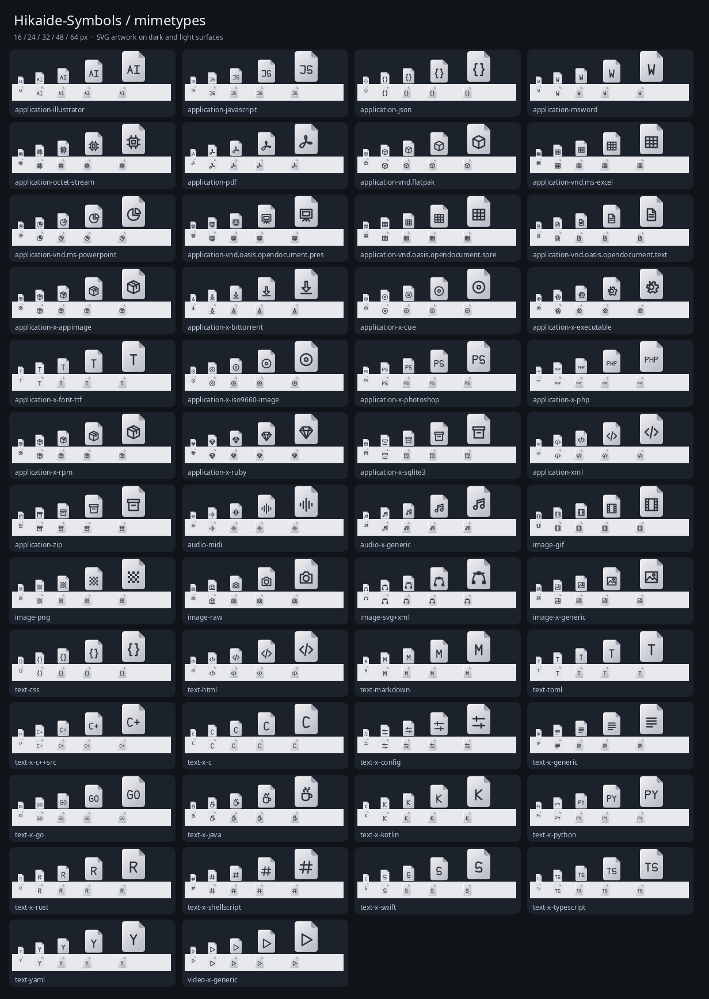
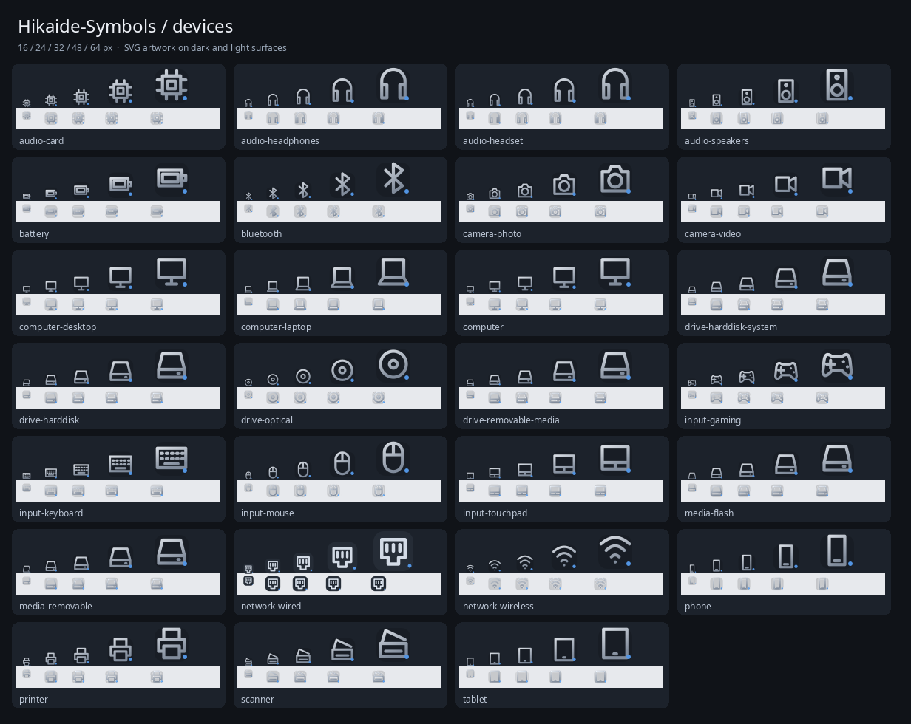
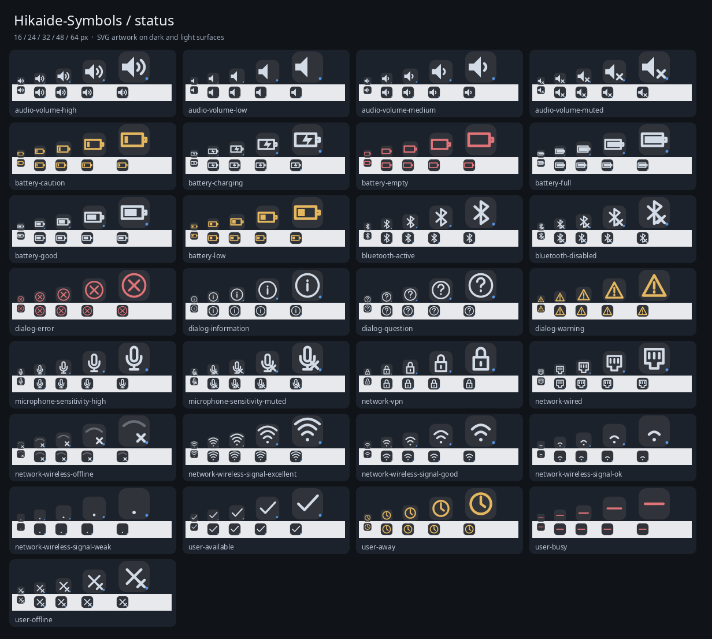
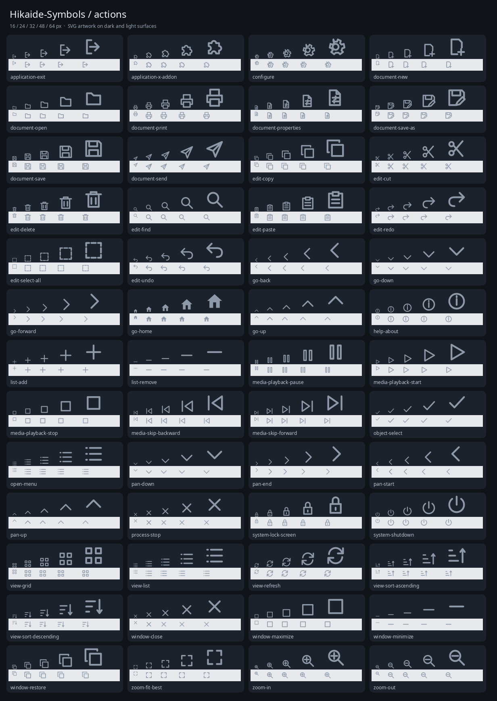
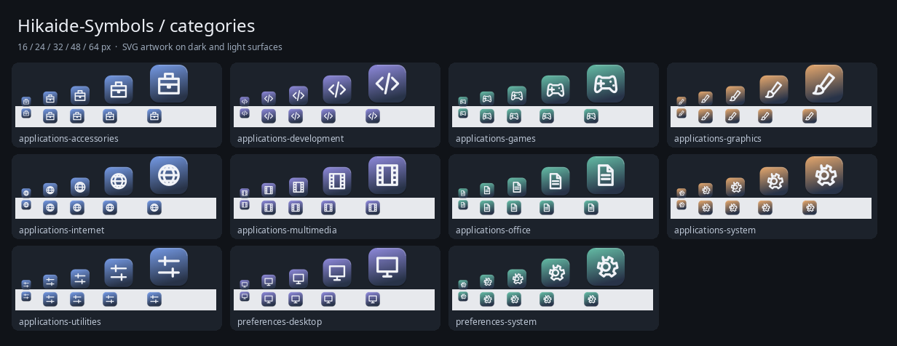
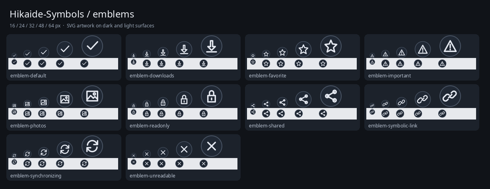

# Hikaide-Symbols

A GTK icon theme with graphite folders, folded paper files, and sculpted application icons.




<details>
<summary>All icon previews</summary>

















</details>

## Install

Requires Python 3.9+. From the repository root:

```sh
python3 scripts/build.py
./scripts/install.sh
```

Installs to `~/.icons/Hikaide-Symbols` without root access. To update an existing installation, rebuild and run `./scripts/install.sh --replace`. Replacement resets installed artwork and accent to the build; save customizations first.

For an XDG installation, add `--xdg` to install, update, and uninstall commands.

## Setup

Select **Hikaide-Symbols** in GNOME Tweaks, Xfce Appearance, or your icon theme selector. On GNOME:

```sh
gsettings set org.gnome.desktop.interface icon-theme 'Hikaide-Symbols'
```

## Uninstall

Select another icon theme, then run:

```sh
./scripts/uninstall.sh
```

[Technical documentation](docs/README.md) · [MIT License](LICENSE)
