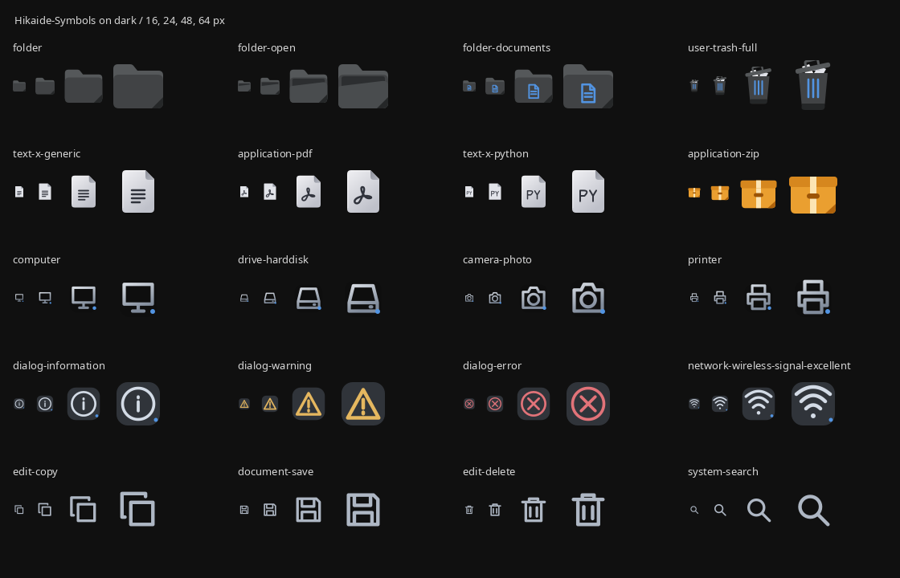
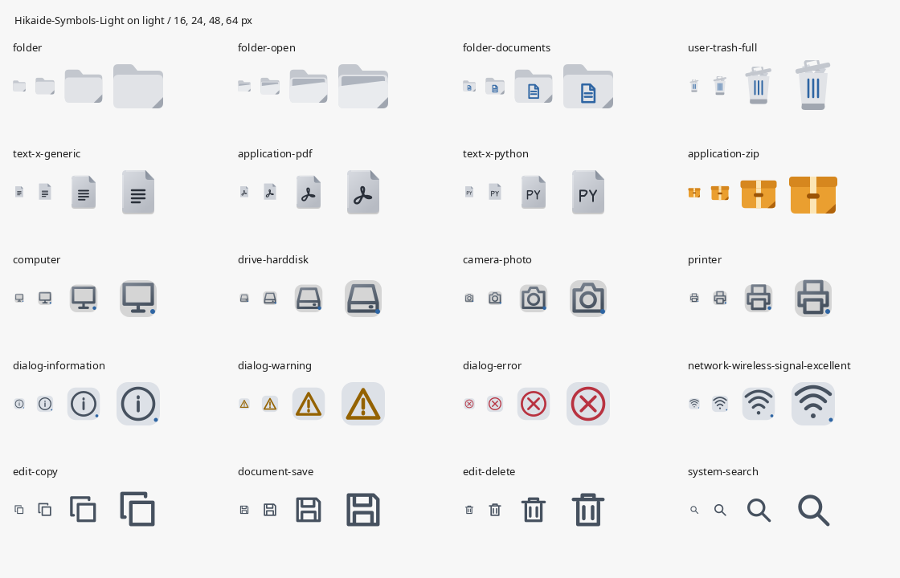

# Hikaide-Symbols

A GTK icon theme with graphite folders in dark mode, white-gray folders and darker gray files in light mode, and system symbols (applications fall back to Adwaita / Breeze).


<details>
<summary>All icon previews</summary>


</details>

## Install

Requires Python 3.9+. From the repository root:

```sh
python3 scripts/build.py
./scripts/install.sh
```

Builds and installs both `~/.icons/Hikaide-Symbols` (dark) and `~/.icons/Hikaide-Symbols-Light` (light) without root access. To update an existing installation, rebuild and run `./scripts/install.sh --replace`. Replacement resets installed artwork and accent to the build; save customizations first.

For an XDG installation, add `--xdg` to install, update, and uninstall commands.

## Setup

Select **Hikaide-Symbols** for dark surfaces or **Hikaide-Symbols-Light** for light surfaces in GNOME Tweaks, Xfce Appearance, or your icon theme selector. On GNOME:

```sh
gsettings set org.gnome.desktop.interface icon-theme 'Hikaide-Symbols-Light'
```

Both variants share names and aliases. Switching mode selects a prebuilt theme; it does not rebuild or recolor SVGs. Neutral paints and the two default accents live in `src/theme/palette.json`. GTK recolors symbolic icons at runtime.




Installation and removal validate the managed pair before changing either theme, with rollback on rename failures. Existing v1 dark installations migrate with `--replace`.

## Uninstall

Select another icon theme, then run:

```sh
./scripts/uninstall.sh
```

[Technical documentation](docs/README.md) · [MIT License](LICENSE)
